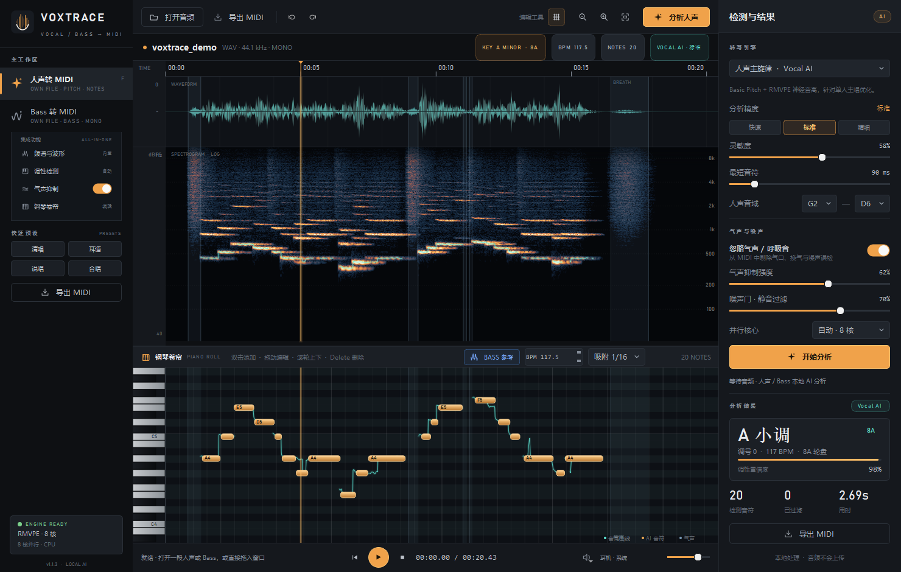
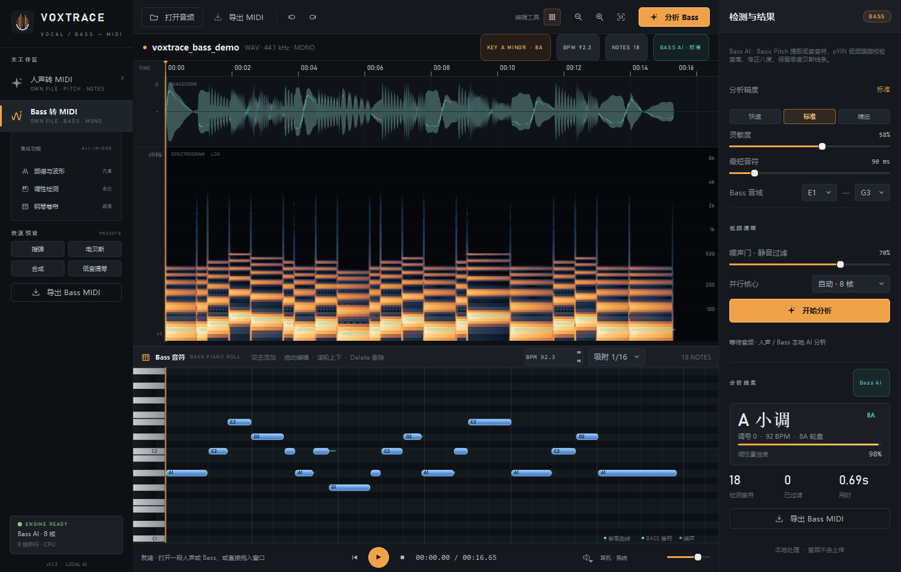

# VoxTrace Studio

**人声 / Bass → MIDI 工作站。** 一个 RX-10 风格的深色音频分析界面：人声与 Bass 两条独立转写工作流，频谱、神经音高、调性、可编辑钢琴卷帘，以及可即时切换的气声抑制。





## Windows EXE（便携版）

已经打包好的免安装版本：

```text
dist\VoxTrace\VoxTrace.exe           解压后的程序
dist\VoxTrace-1.1.3-Windows-x64.zip  便携压缩包，约 482 MB
```

双击 `VoxTrace.exe` 即可运行。**不要只移动 exe**，它旁边的 `_internal` 文件夹包含 Python 运行时、AI 模型和 Qt 插件，必须和 exe 放在一起。整个 `dist\VoxTrace` 文件夹约 760 MB，可整体复制到其他 Windows 10/11 x64 电脑。程序未做代码签名，首次运行若遇到 SmartScreen，请点“更多信息 → 仍要运行”。

- WAV/FLAC 开箱可用；MP3、M4A、OGG 等格式仍需要系统安装 `ffmpeg`。
- 自检命令（不打开窗口，只验证模型与音频链路）：

```text
VoxTrace.exe --self-test
```

## 从源码运行

当前机器上的依赖已装好，直接双击：

```text
run.bat
```

默认会载入并分析一段内置示例人声，立即看到完整效果。也可以：

```text
run.bat --empty              仅打开空白工作区
run.bat D:\vocals\take1.wav  直接打开某个音频
```

也可以把音频文件直接拖进窗口。

其他机器首次使用：

```text
setup_env.bat
run.bat
```

需要 Python 3.11–3.13（64 位）。`requirements.txt` 会安装 PySide6、Librosa、ONNX Runtime、Mido 等依赖。非 WAV/FLAC 格式（MP3、M4A、OGG、AAC）需要系统里有 `ffmpeg`；WAV/FLAC 可直接读取。

> 源码仓库不包含两个 ONNX 权重文件（`rmvpe.onnx` 约 345 MB，超过 GitHub 网页上传限制）。请把 `basic_pitch.onnx` 和 `rmvpe.onnx` 放入 `models/`，来源、校验值和 Git LFS 方法见 [`models/README.md`](models/README.md)。便携版 EXE 已内置这两个文件。

## 核心功能

- **双工作流（完全独立）**：左侧「主工作区」有两个独立入口——**人声转 MIDI** 与 **Bass 转 MIDI**。每个工作区有自己的音频文件、波形/频谱、分析结果、音符、撤销历史、BPM、缩放视口和播放头；来回切换只恢复对应工作区，**不会把当前文件复制到另一边，也不会分析同一个文件**。
- **人声转 MIDI**：Basic Pitch 神经网络负责起音、音长与复音候选；RMVPE 神经音高负责基频与半音级校验；自动清理泛音、重复八度和单声部重叠。橙色音符。
- **Bass 转 MIDI**：专门的低频单音工作流。Basic Pitch 提取贝斯音符，4096 点窗口的 pYIN 低频跟踪校验实际基频并修正八度，强制单音线条，默认音域 E1–G3；蓝色音符，BPM/调性照常检测。适合 UVR / Demucs 分离出的 Bass 轨。
- **RX-10 风格工作区**：深色石墨 + 琥珀色视觉；Bass 模式使用蓝色音符与「BASS AI」状态，和上方人声结果一眼区分。
- **人声频谱**：波形 + 对数频率频谱图同屏，频谱图带 40 Hz–11 kHz 标尺、音高轨迹叠加、气声区域标记、选区与播放头。
- **调性检测**：Krumhansl–Schmuckler 调性轮廓 + 人声音高直方图 + 频谱 chroma；显示大小调、升降号、Camelot 轮盘、置信度与 BPM。
- **钢琴卷帘**：音符块、左侧钢琴键盘、音阶高亮、节拍/小节网格、连续音高曲线；可双击添加、拖动移调、拖边改长度、右键或 Delete 删除、Ctrl+Z 撤销。**鼠标滚轮上下滑动音域，PageUp/PageDown 一次一个八度，Ctrl+Shift+滚轮缩放音域**；`Ctrl+0` 同时适配时间与音域。顶部 **BPM 可直接修正**，网格、节拍与 MIDI 导出速度同步更新。
- **参考 Bass MIDI 泳道**：人声模式下可载入外部 `.mid/.midi`，在钢琴卷帘下方显示独立低音泳道，与主时间轴、缩放、BPM 网格和播放头同步；支持多轨道选择（自动优先选名字含 Bass / ベース / 低音 的轨道）。文件也可直接拖进窗口。该泳道是只读参考，不会改动或混入人声 MIDI 导出；Bass 转 MIDI 模式本身无需它。
- **更可靠的速度检测**：先由人声起音包络估计速度，再用识别出的音符攻击点对齐节拍网格，纠正纯人声容易被误判成三连音速度的问题。
- **忽略气声**：STFT 频谱平坦度、高频能量比、零/低音高置信度联合检测换气与气声；在波形、频谱、钢琴卷帘中标出气声区域，并按强度从 MIDI 中剔除气声误检。已开启时实时生效，不需要重新跑神经网络。
- **噪声门 / 静音过滤**：单独按音符局部电平与音高支持度过滤静音段、底噪和弱噪声产生的假音符。默认 70%，可在右侧「气声与噪声 / 低频清理」中实时调整；设为 0 即关闭。灵敏度只控制神经起音阈值，噪声门才是清理静音段杂音的主开关。
- **精度选项**：快速、标准、精细三档，在速度、召回率和边界精度之间切换。
- **多核并行**：Basic Pitch 的 2 秒窗口按最多 8 线程并行推理；RMVPE 使用 ONNX Runtime 多线程；pYIN（含 Bass 低频跟踪）按音频块多线程。分析在后台线程执行，界面始终可交互。
- **音频输出热切换**：走到条右侧扬声器菜单可固定输出设备，或跟随系统默认；每 1.2 秒检测一次默认端点，插拔耳机、蓝牙、HDMI 或系统切换默认输出时自动跟随并弹出提示，不用重启软件。
- **MIDI 导出**：标准 SMF Type-1，包含速度、拍号、调号、轨道名和力度；导出后可直接拖进 DAW / 编曲软件。

## 精度三档

| 模式 | 音高追踪 | 音符解码 | 适合场景 |
|---|---|---|---|
| 快速 · Fast | pYIN | 单遍 Basic Pitch | 快速预览、说唱、清唱草稿 |
| 标准 · Balanced | RMVPE | 单遍 Basic Pitch | 大多数人声，默认推荐 |
| 精细 · Precise | RMVPE | 双阈值召回 + 音高补全 | 弱起音、气声唱法、需要更完整旋律 |

**Bass 模式**三档都使用 Basic Pitch + 低频 pYIN 校验，差别在音符召回与边界精修：

| 模式 | 适合场景 |
|---|---|
| 快速 | 合成贝斯、边缘清晰的电子低音，快速预览 |
| 标准 | 指弹 / 电贝斯，默认推荐 |
| 精细 | 低音提琴、弱拨弦、长衰减音，召回更完整 |

快捷键：`Ctrl+1` 快速，`Ctrl+2` 标准，`Ctrl+3` 精细。参数改变后需要点「开始分析」重新提取；人声模式下的「忽略气声」「气声强度」「噪声门」会直接重筛已有结果。

> 高灵敏度 + 精细精度会故意放宽弱起音召回，静音段可能出现零散音符。把「噪声门」提高到 75–85%，或改用标准精度，通常即可清理干净。

## 推荐工作流

### 人声转 MIDI

1. 左侧选「人声转 MIDI」，在**这个工作区**拖入一段**干声/清唱**（完整歌曲先用 RX / Demucs / UVR 分离人声）。
2. 选择精度（默认标准）与人声音域。女声/童声可把下限提高一个八度。
3. 打开「忽略气声」，设 55–75%；「噪声门」保持默认 70%，静音段有杂音时提高到 80%。
4. 点「开始分析」。
5. 在钢琴卷帘里修正个别音高/长度；双击空白处可以补音符。
6. 可选：点钢琴卷帘顶部「BASS 参考」载入外部低音 MIDI；示例文件在 `demo/voxtrace_demo_bass.mid`。
7. 「导出 MIDI」。

### Bass 转 MIDI

1. 左侧切到「Bass 转 MIDI」，在**这个工作区**载入分离好的 **Bass 轨**（UVR / Demucs 的 Bass stem 效果最好）。两个工作区的文件互不影响。
2. 音域默认 **E1–G3**，覆盖大多数贝斯；五弦低 B 或高把位可在右侧调整。
3. 选择预设：指弹 / 电贝斯 / 合成 / 低音提琴；然后点「开始分析」。
4. 输出为**单音贝斯线**，蓝色音符。用钢琴卷帘修音高与长度。
5. 「导出 Bass MIDI」，文件名默认带 `_Bass`，不会和人声结果混在一起。

内置 Bass 示例：`demo/voxtrace_bass_demo.wav`（合成电贝斯，18 个音符，A 小调，92 BPM）。

## 快捷键

| 操作 | 快捷键 |
|---|---|
| 打开音频 | `Ctrl+O` |
| 播放 / 暂停 | `Space` |
| 开始分析 | `F` |
| 导出 MIDI | `Ctrl+E` |
| 撤销 / 重做 | `Ctrl+Z` / `Ctrl+Shift+Z` |
| 适配时间与音域 | `Ctrl+0`，或工具栏「显示全部」 |
| 缩放时间轴 | `Ctrl+=` / `Ctrl+-`，或 `Ctrl+滚轮` |
| 钢琴窗上下滑动 | 鼠标滚轮，或 `PageUp` / `PageDown`（一次一个八度） |
| 钢琴窗音域缩放 | `Ctrl+Shift+滚轮` |
| 平移时间轴 | `Shift+滚轮`，或在钢琴卷帘/频谱上左右拖动 |
| 删除音符 | `Delete` / `Backspace` |
| 切换精度 | `Ctrl+1/2/3` |
| 载入参考 Bass MIDI（人声模式） | `Ctrl+B`，或钢琴卷帘顶部「BASS 参考」 |
| 切换音频输出 | 走带条右侧扬声器按钮 |

钢琴卷帘里按住 `Shift` 拖动可临时关闭网格吸附。

## 性能实测

测试机：Intel Core i7-11800H（8 核 / 16 线程），CPU 推理，无 GPU。

| 音频 | 时长 | 标准模式耗时 | 速度 |
|---|---|---|---|
| 人声示例 | 20.4 s | 约 3.0 s（含首次模型加载） | 约 6.8× 实时 |
| 真实独唱《The Star-Spangled Banner》 | 88.1 s | 约 3.9 s | 约 22× 实时 |
| Bass 合成示例 | 16.7 s | 约 0.6 s | 约 27× 实时 |
| 真实 Bass 轨（141.9 s） | 141.9 s | 约 7.0 s | 约 20× 实时 |

人声首次分析会加载约 345 MB 的 RMVPE 模型，后续分析复用已加载会话；快速模式与 Bass 模式不加载 RMVPE，启动更快。

## 工程结构

```text
VoxTrace/
├─ app.py                       启动器、日志、--self-test
├─ run.bat / setup_env.bat      一键运行 / 安装
├─ README.md                    使用说明
├─ CHANGELOG.md                 版本变更记录
├─ THIRD_PARTY_NOTICES.md       第三方归属
├─ models/
│  ├─ basic_pitch.onnx          Basic Pitch 音符模型（Apache-2.0）
│  └─ rmvpe.onnx                RMVPE 人声音高模型（MIT）
├─ voxtrace/
│  ├─ audio_io.py               解码、重采样、临时播放 WAV
│  ├─ basicpitch_decode.py      vendored Basic Pitch 后处理
│  ├─ engine.py                 多核推理、人声/Bass 转写、调性、BPM
│  ├─ midi_io.py                参考 Bass MIDI 读取与轨道解析
│  ├─ notes.py                  音符/调性/呼吸区/MIDI 写入
│  ├─ rmvpe.py                  vendored RMVPE ONNX 推理
│  └─ ui/                       PySide6 界面、钢琴卷帘、Bass 模式与参考泳道
├─ demo/                        合成人声/Bass 示例 + 公有领域真实人声
├─ tests/                       unittest 单元与集成测试
├─ scripts/                     示例生成、截图、Qt 功能冒烟测试
├─ docs/                       截图、开发指南
├─ build_exe.ps1                重新打包 Windows 便携版
└─ dist/VoxTrace/               已打包的 EXE 与运行时
```

运行测试与功能冒烟：

```text
python tests/run_tests.py
python scripts/functional_smoke.py
```

重新生成文档截图：

```text
python scripts/capture_screenshots.py
```

开发说明见 [`docs/DEVELOPMENT.md`](docs/DEVELOPMENT.md)，版本记录见
[`CHANGELOG.md`](CHANGELOG.md)，开发辅助脚本见
[`scripts/README.md`](scripts/README.md)。

重新打包 EXE（需要先安装 `requirements-dev.txt`，其中包含 PyInstaller）：

```powershell
powershell -ExecutionPolicy Bypass -File build_exe.ps1
```

## 已知边界

- 人声模式是**单声部主唱优先**的转写器。「复音 / 和声」模式会保留叠唱，但混合伴奏会明显降低准确率；请先分离人声。
- Bass 模式输出**单音贝斯线**，不适合贝斯和弦、Slap 双音或同时多个低音乐器；请使用分离后的 Bass stem。极低频（低于 E1）或极短闷音可能漏检，可放宽音域并改用精细精度。
- 气声检测是统计 + 神经置信度联合决策，气声唱法、耳语或极轻的假声可能需要调低抑制强度。
- 当前导出的 MIDI 每个音符是固定音高，暂不写入逐帧 pitch bend；颤音会体现在界面音高曲线中，导出后可在 DAW 里再做人性化处理。
- BPM 对自由演唱/无伴奏人声或弱起 Bass 仍可能是一个估计值；可在钢琴卷帘顶部直接输入正确 BPM，音高与调性不受 BPM 影响。
- 长音频且音符很多时，界面使用静态层缓存和音高曲线抽稀；播放、拖动播放头保持流畅，缩放/改视图时才会重绘频谱和音符层。
- EXE 文件夹必须整体移动；单独拿走 `VoxTrace.exe` 会缺少 `_internal` 里的运行时和模型。
- 打包版没有内置 ffmpeg；MP3 / M4A / OGG 等压缩格式仍需系统 `ffmpeg`。WAV/FLAC 无需额外组件。
- 模型与音频全部本地处理，不上传、不联网（首次安装依赖除外）。

## 开源与许可

本项目站在这些项目之上：**Spotify Basic Pitch**（Apache-2.0）、**RMVPE**（MIT）、**Librosa**（ISC）、**Mido**（MIT）和 **Qt for Python / PySide6**（LGPLv3）。完整许可见 [`THIRD_PARTY_NOTICES.md`](THIRD_PARTY_NOTICES.md) 与 `licenses/`。

示例之外的真实人声 `demo/navy_solo.oga` 为美国海军军乐队演奏/演唱的美国国歌，属于美国联邦政府公有领域作品。
